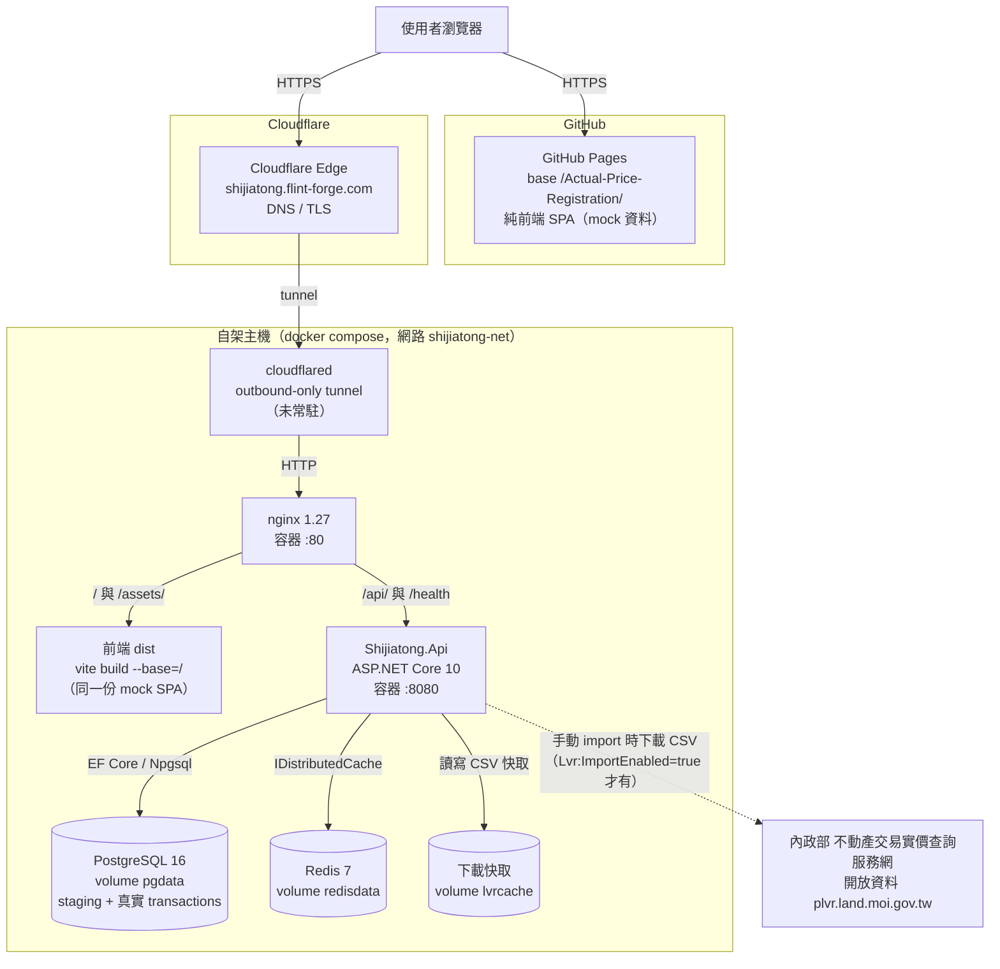
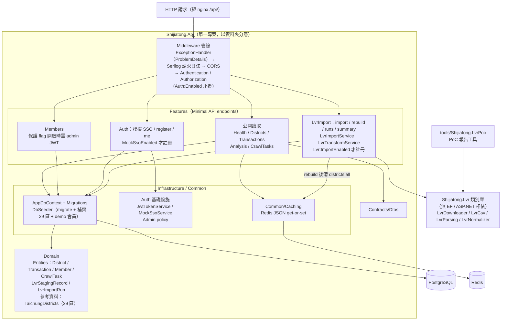
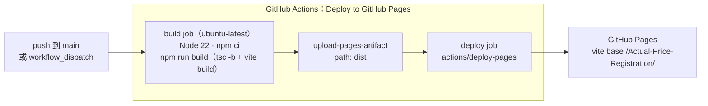
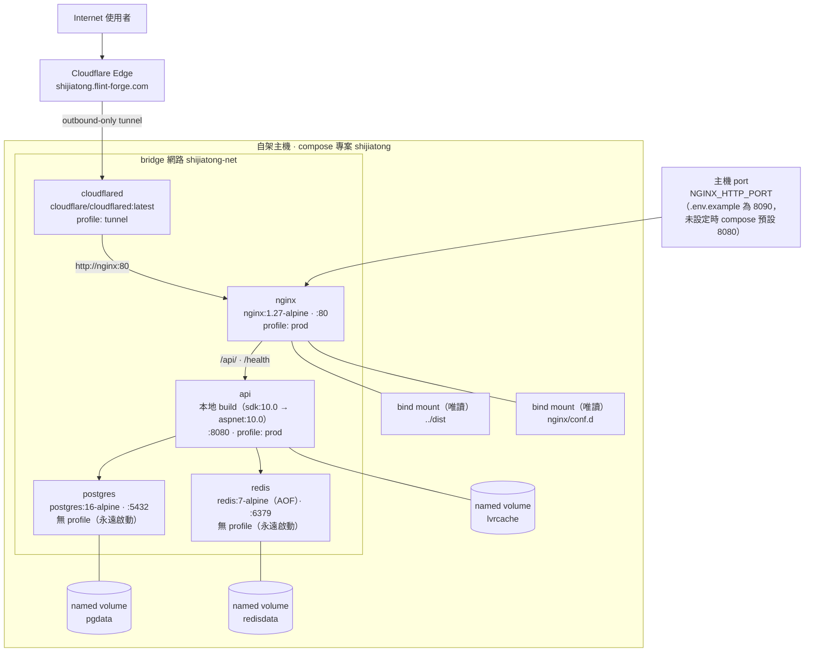
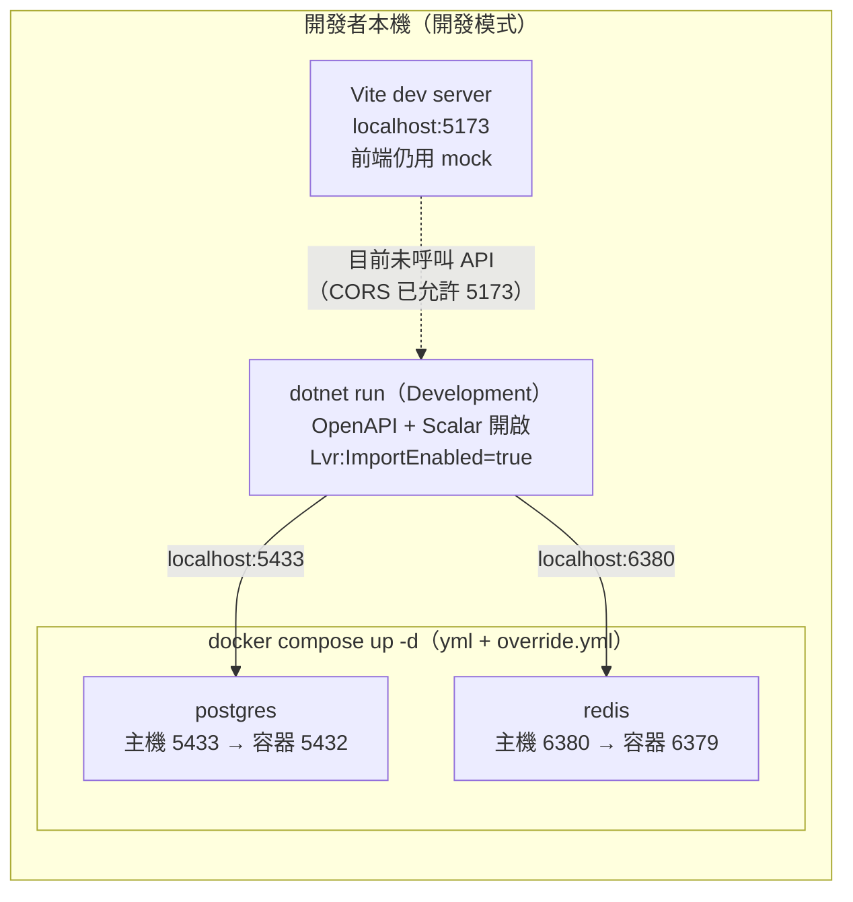
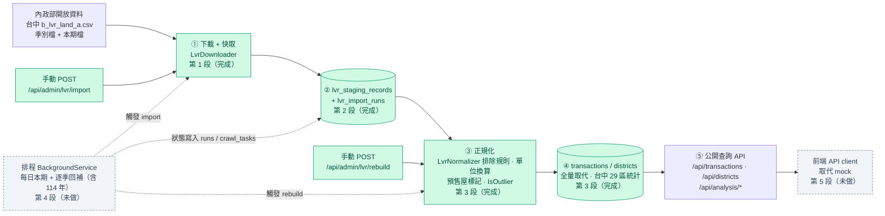
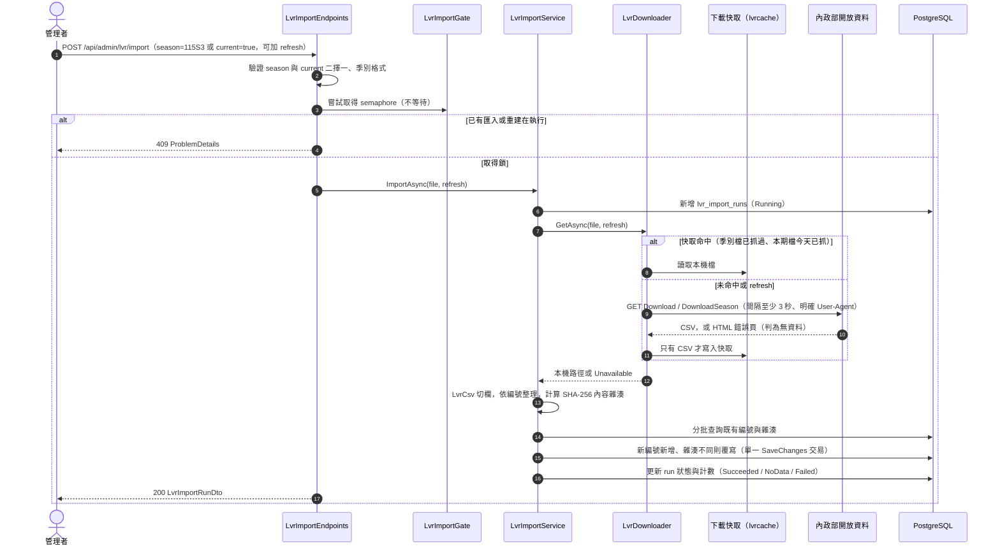
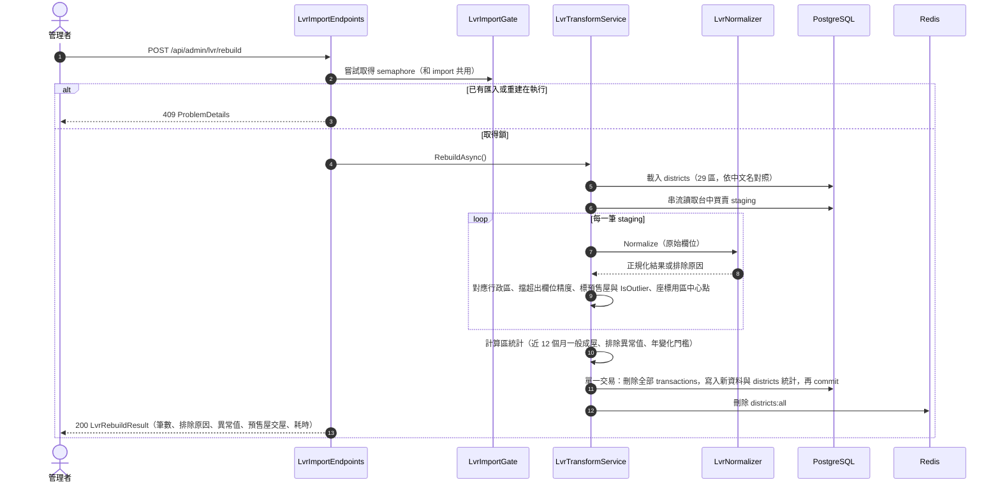
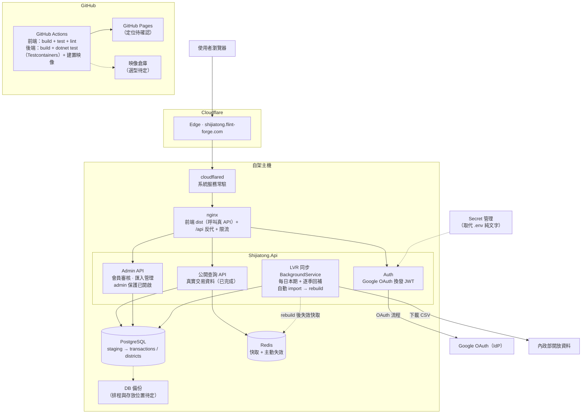

# 實價通 — 專案現況與架構

> **基準**：分支 `feat/lvr-import-poc` @ `c3c2e88`（包含 `implement-shijiatong` 全部內容、實價登錄匯入第 1–3 段，以及 compose `Auth__*` 修正 `5df1431`），整理日期 2026-11-01。
> **根據**：每個陳述都標了來源檔。repo 內查不到的一律寫「待確認」，集中在[附錄 D](#附錄-d待確認清單)。主線提供的實測數字另外註明「主線實測」。
> 相關文件：[`backend/docs/ARCHITECTURE.md`](../backend/docs/ARCHITECTURE.md)、[`functional-architecture.md`](../backend/docs/functional-architecture.md)、[`docker-compose.md`](../backend/docs/docker-compose.md)、[`auth-plan.md`](../backend/docs/auth-plan.md)、[`lvr-import-poc.md`](../backend/docs/lvr-import-poc.md)、[`schema.dbml`](../backend/docs/schema.dbml)。

---

## 1. 定位與目前階段

**實價通**是台中市的實價登錄查詢服務，提供搜尋、成交紀錄、行情分析、房價地圖和會員後台。前端是 Vite + React 18 + TypeScript 的單頁應用（SPA），後端是 ASP.NET Core 10 + PostgreSQL + Redis，透過 nginx 和 Cloudflare Tunnel 對外。

- **前端**：所有畫面都做好了，但資料仍全部來自 mock（`src/data/*.ts`），程式內沒有任何 API 呼叫。前端部署在 GitHub Pages。
- **後端**：查詢、分析、會員、認證（Stage 1–3，由 flag 控制、預設全關）都已完成。整套容器在自架主機上執行，由 nginx 以同源方式同時提供前端與 `/api`。
- **資料**：第 3 段（`c3c2e88`）已完成。公開端點改為回傳**內政部開放資料的真實成交**，demo 成交已移除。主線實測：staging 31,826 筆，轉成 transactions 25,745 筆，台中 29 區中有 28 區有資料。下一步是第 4 段：排程自動更新，並回補 114 年季別，補齊後年變化才算得出來。
- **待部署**：第 3 段與 A1 修正（compose 傳遞 `Auth__*`）都還沒部署到 prod。prod 的 admin 保護也還沒開，需要使用者設定 prod `.env`。上線順序見 §8。

---

## 2. 實作狀態總表

圖例：✅ 完成　🔶 部分／有限制　🚧 進行中　⬜ 未做

### 2.1 前端（`src/`）

| 模組 | 狀態 | 說明 | 根據 |
|---|:---:|---|---|
| 搜尋 `SearchView` | ✅ | 行政區卡片（mock 12 區）與篩選條件，資料來自 mock | `src/App.tsx`、`src/data/mock.ts` |
| 成交紀錄 `ResultsView` | ✅ | 卡片／表格兩種檢視與排序，用純函式 `filterTransactions` 處理 mock 22 筆 | `src/lib/query.ts` |
| 物件詳情 `DetailView` | ✅ | 單筆詳情與社區趨勢（mock） | `src/components/DetailView.tsx` |
| 行情分析 `AnalysisView` | ✅ | 全市趨勢、行政區排行、價格分布（mock） | `src/components/AnalysisView.tsx` |
| 房價地圖 `MapView` | ✅ | 全台縣市 3D 柱狀圖，純 SVG 繪製。`taiwanGeo.ts` 是產生出來的檔案，repo 內沒有產生它的腳本 | `README.md`、`src/data/taiwanGeo.ts` |
| 地圖探索 `MapDrillView` | ✅ | 縣市可往下鑽到行政區，但只有台中有區級資料（mock） | `src/data/mapDrill.ts` |
| 資料來源 `DataView` | 🔶 | 顯示 mock 的 `CRAWL_TASKS`，不是真實狀態（第 4 段才會改） | `src/components/DataView.tsx` |
| 匯出 `ExportModal` | 🔶 | 只有選格式、選欄位的 UI 和約 1.4 秒的「產生中」動畫，不會真的產生檔案 | `src/components/DataView.tsx` |
| 登入／註冊 `AuthView` | 🔶 | 模擬 Google／Apple SSO，資料存在 localStorage，沒有接後端 | `src/lib/auth.ts` |
| 會員管理 `AdminView` | 🔶 | 審核流程用 localStorage 模擬，沒有接 `/api/members` | `src/components/admin/AdminView.tsx` |
| Tweaks 面板 | ✅ | 主題、密度、版面等設定，存在 localStorage | `src/components/tweaks/Tweaks.tsx` |
| 前端串接後端 API | ⬜ | `src/` 內沒有 `fetch` 或 API client（roadmap E1/E2）。TopBar 的「最後同步」時間寫死為 `2026-05-28 03:40`。後端契約已變更，見 §2.2 附註 | `src/App.tsx` |
| 前端測試 | 🔶 | vitest 共 11 個案例（`format`、`query`），但 CI 沒有執行 | `src/lib/*.test.ts`、`.github/workflows/deploy.yml` |

### 2.2 後端 API（`backend/src/Shijiatong.Api/Features/`）

| 端點群 | 狀態 | 說明 | 根據 |
|---|:---:|---|---|
| Health：`/health`、`/health/ready` | ✅ | `ready` 會檢查 PG 能否連線，並對 Redis 做一次寫入加讀取 | `Features/Health/HealthEndpoints.cs` |
| Districts：`GET /api/districts`、`/{id}` | ✅ | **真實資料**：台中 29 區，其中和平區目前 0 筆。統計在 rebuild 時計算：近 12 個月、只算一般成屋、排除異常值。`change`（年變化）目前全為 null，見 R19。列表透過 Redis 快取（`districts:all`，TTL 5 分鐘），rebuild 完會主動清除 | `Features/Districts/DistrictEndpoints.cs`、`LvrTransformService.cs` |
| Transactions：`GET /api/transactions`、`/{id}` | ✅ | **真實資料**：rebuild 後 25,745 筆，`id` 改為官方編號，demo 的 `T0001` 回 404（主線實測）。篩選條件有區、關鍵字、型態、格局、交易別，以及總價、單價、坪數、屋齡、日期的區間；排序欄位有白名單；每頁最多 200 筆。列表和詳情**不會**排除異常值，只用 `isOutlier` 標示 | `Features/Transactions/TransactionEndpoints.cs`、`Contracts/Dtos.cs` |
| Analysis：`/api/analysis/*` | ✅ | 5 個端點都排除 `IsOutlier`，也都支援 `trade` 參數（例如 `trade=成屋` 可濾掉預售屋交屋）。`city-trend` 改用真實資料，取最新交易月往前 12 個月。`district-summary` 的年增率已套用和區統計相同的樣本門檻（見 R20，已解決） | `Features/Analysis/AnalysisEndpoints.cs` |
| CrawlTasks：`GET /api/crawl-tasks` | 🔶 | 仍回傳靜態 demo 種子（8 筆），沒有真正執行任何任務（roadmap B3／第 4 段） | `Features/CrawlTasks/`、`DbSeeder.cs` |
| Members：`GET`、`PATCH /{id}/status`、`/{id}/plan` | ✅ | 可讀可寫，但資料仍是 demo 種子會員。admin 保護的機制已經有了，**prod 還沒開**（見 §2.3） | `Features/Members/MemberEndpoints.cs` |
| Auth：`POST /api/auth/sso/{provider}`、`/register`、`GET /me` | ✅（mock） | 只在 `Auth:MockSsoEnabled=true` 時才註冊路由 | `Features/Auth/AuthEndpoints.cs` |
| LVR 管理：`POST /api/admin/lvr/import`、`POST /rebuild`、`GET /runs`、`GET /staging/summary` | ✅ | 只在 `Lvr:ImportEnabled=true` 時才註冊，prod 預設關。import 和 rebuild **共用同一把 semaphore**，同時第二個請求回 409 | `Features/LvrImport/*` |
| OpenAPI／Scalar | ✅ | 只在 Development 開放（`/openapi/v1.json`、`/scalar`） | `Program.cs` |
| 統一錯誤模型 | ✅ | 回傳 RFC 9457 ProblemDetails | `Program.cs` |
| 日誌 | ✅ | Serilog 以 CompactJson 格式輸出到 console | `Program.cs`、`serilog.json` |
| Metrics／OpenTelemetry | ⬜ | roadmap D4 | `backend-roadmap.md` |
| Rate limiting（API 與 nginx） | ⬜ | `api.conf` 沒有 `limit_req`；auth 端點限流列在 roadmap A4 | `nginx/conf.d/api.conf` |

> **API 契約變更**（第 3 段，前端還沒串接，所以目前不影響畫面）：`TransactionDto` 新增 `address`、`isOutlier`，`community`、`section`、`age` 可為 null；`DistrictDto` 新增 `lat`、`lng`，`zone`、`change` 可為 null。根據：`Contracts/Dtos.cs`、`lvr-import-poc.md`。

### 2.3 認證／授權（`backend/docs/auth-plan.md`）

| 項目 | 狀態 | 說明 | 根據 |
|---|:---:|---|---|
| Stage 1：授權骨架與 feature flag | ✅ | `Auth:Enabled` 預設 false，只在 flag 開啟時才掛 `UseAuthentication`／`UseAuthorization` | `Program.cs`、`Infrastructure/Auth/AuthOptions.cs` |
| Stage 2：admin JWT 保護 `/api/members` | ✅（機制） | `RequireAdminWhenProtected` 要 `Enabled` 和 `ProtectAdminEndpoints` 都是 true 才生效 | `Infrastructure/Auth/AdminAuthorizationExtensions.cs` |
| Stage 3：模擬 SSO 發 JWT、`Member.Role` | ✅ | admin 名單由 `Auth:AdminEmails` 設定決定；對應 migration 是 `AddMemberRole` | `Infrastructure/Auth/MockSsoService.cs`、`Migrations/` |
| Stage 4：真 Google OAuth | ⬜ | auth-plan 只列了待辦，沒有細部規劃（roadmap A2） | `auth-plan.md` |
| **A1：prod 開啟 admin 保護** | 🔶 | **程式已修正、待部署**。原本 compose 的 `api` 沒有 `env_file`，`environment` 也沒列 `Auth__*`，所以在 prod `.env` 設定不會生效。`5df1431` 已在 compose `environment` 明確對應 `Auth__*`。部署後仍要使用者在 prod `.env` 設 flag、簽章金鑰和 admin email，再重建 api | `backend/docker-compose.yml`、`.env.example`、`backend-roadmap.md` A1 |

### 2.4 實價登錄資料匯入（roadmap B，`backend/docs/lvr-import-poc.md`）

| 段 | 狀態 | 內容 | 根據 |
|---|:---:|---|---|
| 第 1 段 PoC | ✅ | `Shijiatong.Lvr` 類別庫：CSV 解析、民國日期與中文樓層轉換、正規化與排除規則、有節制地下載並快取。另有 PoC 工具產生報告 | `src/Shijiatong.Lvr/*`、`tools/Shijiatong.LvrPoc/`、`docs/lvr-poc-report.md` |
| 第 2 段 staging | ✅ | 兩張表：`lvr_staging_records`（主鍵是官方編號，原始欄位存成 jsonb，另存 `ContentHash`）和 `lvr_import_runs`。匯入由手動呼叫端點觸發，下載快取放在 `lvrcache` volume。實測 31,826 筆 | `Features/LvrImport/LvrImportService.cs`、`Migrations/20261031124150_AddLvrStaging.cs` |
| 第 3 段 正規化與重建 | ✅ | `POST /api/admin/lvr/rebuild`：讀取全部台中買賣 staging，經 `LvrNormalizer` 正規化，在**同一交易內全量取代** `transactions`，重算 29 區統計，最後清除 `districts:all` 快取。決策都已實作：預售屋交屋標 `Trade=預售屋`；單價 < 5 或 > 200 萬/坪標 `IsOutlier`；社區名、重劃區、生活圈、屋齡可為空，並新增 `Address`；座標先用行政區中心點；29 區沿用拼音 id。migration `ReplaceDemoWithLvrData` 刪除 demo 成交 | `Features/LvrImport/LvrTransformService.cs`、`Domain/TaichungDistricts.cs`、`Migrations/20261031135705_ReplaceDemoWithLvrData.cs` |
| 第 4 段 排程與回補 | ⬜ | 用 BackgroundService 每天檢查本期資料、逐季回補（**包括 114 年季別，年變化才算得出來**），狀態寫進 `crawl_tasks` 和 import runs，讓前端「資料來源」頁顯示真實狀態 | 主線規劃、`lvr-import-poc.md`、`backend-roadmap.md` B3 |
| 第 5 段 前端串接 | ⬜ | 前端改用 API client 取代 mock，並加上 JWT token 流程（即 roadmap E1/E2） | `backend-roadmap.md` E |

### 2.5 部署／維運／品質

| 項目 | 狀態 | 說明 | 根據 |
|---|:---:|---|---|
| 前端 CI/CD（GitHub Pages） | ✅ | push 到 `main` 或手動觸發：`npm ci`、`npm run build`，再部署到 Pages | `.github/workflows/deploy.yml` |
| Compose 分層與 profiles | ✅ | base 加上 dev override 與 prod 檔；profiles 有 `prod`、`tunnel` | `backend/docker-compose*.yml` |
| nginx 同源服務 | ✅ | `/` 提供前端 dist（SPA fallback），`/api/` 與 `/health` 反向代理到 `api:8080` | `nginx/conf.d/api.conf` |
| 啟動時自動 migrate 與基礎資料 | ✅ | 會退避重試（最多 12 次，每次間隔 3 秒）。`DbSeeder` 不再灌 demo 成交，改成 `EnsureDistrictsAsync` 補齊 29 區，只同步名稱、生活圈、中心點，不動統計。會員和 `crawl_tasks` 在空表時仍會灌 demo | `Program.cs`、`Infrastructure/DbSeeder.cs` |
| 舊版 DB 升級路徑 | ✅ | 主線用舊版 DB（12 區、22 筆 demo）換新版啟動，驗證過兩次：demo 被清空、29 區補齊、staging 保留，之後 import 和 rebuild 都正常 | 主線實測、`ReplaceDemoWithLvrData.cs` |
| 重啟或重建後資料保留 | ✅ | 已實測 `restart`、`up --build`、`down` 再 `up` | `docker-compose.md` §7 |
| Cloudflare Tunnel | 🔶 | 可以連，但**不是常駐**，session 結束就斷（roadmap D1） | `backend-roadmap.md` D1 |
| 自架站的前端 dist | 🔶 | 要手動用 `vite build --base=/` 產出 `../dist`，再由 compose 唯讀掛進 nginx，沒有自動化 | `docker-compose.yml` 中 nginx volumes 的註解 |
| 後端 CI | ⬜ | 沒有 build、`dotnet test` 或推映像的 workflow（roadmap D2） | `.github/workflows/` 只有 `deploy.yml` |
| DB 備份 | ⬜ | 只有 named volume `pgdata`，沒有備份機制（roadmap D6） | `backend-roadmap.md` D6 |
| Secrets 管理 | 🔶 | 用 `.env` 純文字檔（已 gitignore）；prod 應改用 secret manager（roadmap D3） | `backend/.gitignore`、`backend-roadmap.md` D3 |
| 快取失效 | 🔶 | rebuild 會主動清除 `districts:all`；其他情境仍只靠 5 分鐘 TTL（roadmap D5） | `LvrTransformService.cs`、`DistrictEndpoints.cs` |
| 後端測試 | ✅ | API 測試 49 個方法、52 個案例：其中 `DistrictStatsTests` 5 個是純邏輯測試，其餘用 xUnit + Testcontainers 跑 PG/Redis，fixture 會走「假下載來源 → import → rebuild」準備資料。Lvr 單元測試 22 個方法、59 個案例 | `backend/tests/**` |

---

## 3. 目前架構圖

### 3.1 系統全景（2026-11-01 現況）

同一份前端部署在兩個地方：**GitHub Pages**（純 mock），以及自架主機上 **nginx** 同源提供的版本。兩份目前都**不會呼叫 API**。後端公開端點在 rebuild 之後已經是真實資料，只是還沒有畫面在用。

說明：

- cloudflared 實際怎麼跑（compose 容器的 token 模式，或主機上的 cloudflared CLI），以及 ingress 指向哪裡（`nginx:80` 或主機 port），都**待確認**，見附錄 D。
- 本機驗證環境的資料流是：import 寫進 `lvr_staging_records`，rebuild 再轉成 `transactions`／`districts`，公開端點讀後者。prod 目前跑哪個版本**待確認**；照上線順序，prod 在 rebuild 之前公開成交會是空的（見 R21）。

### 3.2 API 內部分層

說明：

- 依賴方向是 `Features → Infrastructure/Common → Domain`（`functional-architecture.md` §B）。
- import（`LvrImportService`）用到 `LvrCsv`、`LvrColumns`、`LvrSources` 和下載器；rebuild（`LvrTransformService`）用到 `LvrNormalizer`。PoC 工具也共用同一個類別庫。

---

## 4. 部署圖

### 4.1 前端：GitHub Actions → GitHub Pages

- workflow 不跑 `npm test` 和 `npm run lint`，型別檢查只靠 `tsc -b`（`deploy.yml`、`package.json`）。
- 分支慣例：在 `implement-shijiatong` 開發，推到 `main` 才觸發部署（`deploy.yml` 只監聽 `main`）。

### 4.2 後端：自架主機上的 docker compose（正式模式加 tunnel）

**啟動相依與健康檢查**（`docker-compose.yml`）：`postgres`（`pg_isready`）和 `redis`（`redis-cli ping`）都 healthy 後才啟動 `api`；`api` 的 `curl /health` 通過後才啟動 `nginx`；`cloudflared` 只對 `nginx` 做一般的 `depends_on`。

**Profile 矩陣**（`docker-compose.md` §2）：

| 指令 | postgres | redis | api | nginx | cloudflared |
|---|:---:|:---:|:---:|:---:|:---:|
| `docker compose up -d`（dev，自動載入 override） | ✅ | ✅ | – | – | – |
| `-f docker-compose.yml -f docker-compose.prod.yml --profile prod up -d --build` | ✅ | ✅ | ✅ | ✅ | – |
| 上一行再加 `--profile tunnel` | ✅ | ✅ | ✅ | ✅ | ✅ |

### 4.3 開發模式與正式模式

| 面向 | 開發模式 | 正式模式 |
|---|---|---|
| API 在哪裡跑 | 本機 `dotnet run`，讀 `appsettings.Development.json` | 容器 `api`，`ASPNETCORE_ENVIRONMENT=Production` |
| compose 檔 | `docker-compose.yml` 加上自動載入的 `override.yml` | 用 `-f` 指定 `docker-compose.yml` 和 `docker-compose.prod.yml`，不會載入 override |
| PG／Redis 對外 port | 開 5433／6380，可用 `POSTGRES_PORT`／`REDIS_PORT` 覆寫 | 不開，只走內網 |
| 連線字串 | `localhost:5433`、`localhost:6380` | `Host=postgres`、`redis:6379`，由 compose `environment` 注入 |
| nginx／cloudflared | 不啟動 | `prod` profile 啟動 nginx；`tunnel` profile 啟動 cloudflared |
| OpenAPI／Scalar | 開 | 關 |
| LVR import／rebuild 端點 | 開（`appsettings.Development.json`） | 預設關（`LVR_IMPORT_ENABLED` 預設 false） |
| 下載快取位置 | `backend/.lvr-cache/`（已 gitignore） | volume `lvrcache`，掛在 `/data/lvr-cache` |
| restart 策略 | `unless-stopped` | `always`（`docker-compose.prod.yml`） |
| API 對外 port | README 寫 `localhost:8080`，但 repo 沒有 `launchSettings.json`，也沒設 URL，**待確認** | 只在內網 `:8080`，經 nginx 對外 |

---

## 5. 資料匯入流程

### 5.1 整體管線（第 1–5 段）

匯入完之後要再手動呼叫一次 rebuild，公開端點才會更新。第 4 段的排程會把這兩步自動串起來（`lvr-import-poc.md`）。

### 5.2 第 2 段：一次手動匯入的時序

### 5.3 第 3 段：重建時序（已實作）

### 5.4 實測結果（主線實測，拋棄式容器，115S1–S3 加本期）

| 指標 | 數值 |
|---|---|
| staging → transactions | 31,826 → 25,745 筆 |
| 異常值（`IsOutlier`） | 39 筆（只在列表和詳情顯示，統計會排除） |
| 預售屋交屋（`Trade=預售屋`） | 13,342 筆 |
| 有資料的行政區 | 28／29 區（和平區 0 筆） |
| 區統計範例（近 12 個月一般成屋） | 北屯 1,793 筆、35.7 萬/坪；西屯 1,487 筆、36.9；北區 947 筆、29.9；南屯 936 筆、38.2 |
| 年變化 `ChangePct` | 29 區全部是 null（前期樣本不足，見 R19） |
| 耗時 | 每個檔案 import ≤ 3 秒；rebuild 6.2 秒，第二次升級驗證 5.6 秒；重跑結果一致 |
| demo 是否清除 | `GET /api/transactions/T0001` 回 404 |

---

## 6. 目標架構

### 6.1 目標架構圖（第 4、5 段與維運收尾都完成後）

### 6.2 現況與目標的差異

| 面向 | 現況 | 目標 | 對應項目 |
|---|---|---|---|
| 資料內容 | ✅ 公開端點已是真實資料（115 年 S1–S3 加本期，25,745 筆，29 區） | 維持，並回補 114 年以前的季別 | 第 3 段（完成）、第 4 段 |
| 資料更新 | 手動 import 再手動 rebuild，prod 預設關 | BackgroundService 每天自動 import 和 rebuild；`crawl_tasks` 與 runs 記錄真實狀態 | 第 4 段、B3 |
| 年變化 | 前期樣本不足，29 區全部是 null | 回補 114 年季別後自動算出 | 第 4 段、R19 |
| 座標 | 用行政區中心點，同一區所有成交落在同一點 | 門牌 geocoding | `lvr-import-poc.md` 決策 4 |
| 前端資料來源 | mock（`src/data/*.ts`），會員存在 localStorage | API client 加上 JWT Bearer，並處理可為 null 的新契約；「資料來源」頁顯示真實狀態 | 第 5 段、E1/E2 |
| 認證 | 模擬 SSO（flag 預設關）；A1 已修正但還沒部署 | Google OAuth 換發 JWT，prod 開 admin 保護，關閉 mock 路由 | A1、A2（Stage 4） |
| 對外通道 | tunnel 不是常駐 | cloudflared 以系統服務常駐 | D1 |
| CI | 只有前端 build 加部署到 Pages | 前後端都跑測試，並建置後端映像 | D2 |
| 備份 | 沒有 | 定期備份 PG，至少要有 `members`（無法從開放資料重建） | D6 |
| 機密 | `.env` 純文字 | secret manager | D3 |
| 快取 | TTL 5 分鐘，rebuild 會主動清 `districts:all` | 其他寫入路徑也主動失效，或改用 ETag | D5 |
| 防護 | nginx 和 API 都沒有限流 | nginx `limit_req`，加上 auth 端點限流 | A4 |
| 觀測 | 只有 Serilog console log | metrics／OpenTelemetry | D4 |

---

## 7. 已知風險與技術債

| # | 項目 | 嚴重度 | 現況與影響 | 根據 |
|---|---|:---:|---|---|
| R1 | **prod admin 保護未生效** | 高 | prod 的 `/api/members` GET 和 PATCH 可以匿名呼叫，因為保護 flag 預設關 | `backend-roadmap.md` A1、`appsettings.json` |
| R2 | **compose 沒把 `Auth__*` 傳進容器** | 高→待部署 | **已修正（`5df1431`），待部署**。修正前只在 `.env` 設 `Auth__Enabled=true` 不會生效。部署後仍要設 prod `.env`（`SigningKey`、`AdminEmails`）並重建 api，A1 才算完成 | `docker-compose.yml`、`.env.example` |
| R3 | prod 誤開 `MockSsoEnabled` | 高 | 模擬 SSO 讓任何人都拿得到 admin token。`.env.example` 已加警告 | `.env.example`、`MockSsoService.cs` |
| R4 | admin 保護生效前就開 LVR 端點 | 高 | 任何人都能觸發下載、寫入，以及**全量取代 transactions 的 rebuild**。目前預設關 | `lvr-import-poc.md`、`docker-compose.yml` |
| R5 | Tunnel 不是常駐 | 中 | session 結束網站就斷。repo 內的 token 模式說明（`api.<your-domain>`）可能和實際網域、運行方式不一致 | `backend-roadmap.md` D1、`cloudflared/README.md` |
| R6 | 沒有後端 CI；前端 CI 不跑測試 | 中 | 52 個 API 測試案例和 59 個 Lvr 單元測試案例只在本機跑；vitest 和 lint 都沒進 workflow | `.github/workflows/deploy.yml` |
| R7 | 沒有 DB 備份 | 中 | `pgdata` 只靠 named volume，`down -v` 或主機故障就會遺失。會員資料無法重建；交易資料可以從 staging 或開放資料重新 import 加 rebuild 補回 | `docker-compose.md` §7、roadmap D6 |
| R8 | Secrets 管理 | 中 | `.env` 是純文字；變數沒設時 compose 會讓 `POSTGRES_PASSWORD` 退回預設 `shijiatong` | `docker-compose.yml`、roadmap D3 |
| R9 | 快取失效 | 低 | **重建情境已解決**：rebuild 會主動清 `districts:all`。其他情境，例如 `DbSeeder` 啟動時同步區名稱，仍只靠 5 分鐘 TTL | `LvrTransformService.cs`、`DistrictEndpoints.cs` |
| R10 | DbSeeder 回灌 demo | — | **已解決**：`DbSeeder` 不再灌 demo 成交，只補齊 29 區、不動統計；migration 會刪除 T0001–T0022 | `DbSeeder.cs`、`ReplaceDemoWithLvrData.cs` |
| R11 | 同步端點可能碰到 nginx 逾時 | 低 | `proxy_read_timeout 30s`。以目前資料量，每個 import ≤ 3 秒、rebuild 約 6 秒，**不會觸發**。rebuild 是全量重建，回補多年季別、資料量變大後要留意；逾時時用戶端會拿到 504，但 import 會照樣跑完（端點刻意不綁 `RequestAborted`） | `api.conf`、`LvrImportEndpoints.cs`、主線實測 |
| R12 | 匯入鎖只在單一程序內 | 低 | `LvrImportGate` 是程序內的 semaphore，只適用單一 api 實例 | `LvrImportService.cs` |
| R13 | 自架站前端要手動 build | 低 | 要另外用 `--base=/` build，因為 committed 的 base 是給 Pages 用的 `/Actual-Price-Registration/`；沒有自動化 | `vite.config.ts`、`docker-compose.yml` |
| R14 | 映像版本沒釘選 | 低 | `cloudflare/cloudflared:latest` | `docker-compose.yml` |
| R15 | 仍有假資料 | 低 | **部分解決**：`city-trend` 已改用真實資料。`crawl_tasks` 仍是靜態種子，會員仍是 demo 種子，前端「最後同步」時間仍寫死 | `AnalysisEndpoints.cs`、`DbSeeder.cs`、`App.tsx` |
| R16 | 開放資料授權與出處標示 | 中 | 文件寫「授權條款與出處標示方式待正式匯入前確認」，現在真實資料已經要上線 | `lvr-import-poc.md` |
| R17 | 文件和程式不一致 | 低 | `ARCHITECTURE.md` 還寫 ASP.NET Core 8、Swagger/Swashbuckle（實際是 `Microsoft.AspNetCore.OpenApi` 加 Scalar）、nginx「限流」（實際沒設），Phase 0 勾選框也沒更新，種子仍描述為 demo 成交。`functional-architecture.md` 寫會員端點未授權，`city-trend` 寫成代表值。README 和 docker-compose.md 的 nginx port 不一致（8080／8090） | 各文件與程式碼比對 |
| R18 | 資料本身的陷阱 | 中 | 預售屋交屋已標記，但它的交易日是當年簽約日，趨勢類查詢要搭配 `trade=成屋`。有 5,175 筆車位價併入總價。買賣檔沒有社區名和實際座標，所有點都落在區中心 | `lvr-import-poc.md` |
| R19 | **年變化資料不足** | 中 | 目前只匯入 115 年季別，前 12 個月幾乎都是遲延登記（文件例子：西屯近 12 月 1,489 筆，前 12 月只有 50 筆），硬算會得到約 -23% 的假跌幅。所以 `ChangePct` 只在前期 ≥ 10 筆且 ≥ 近期筆數一半時才計算，**目前 29 區全部是 null**。要等第 4 段回補 114 年季別；前端串接時也要能處理 null | `LvrTransformService.cs`、`lvr-import-poc.md` |
| R20 | ~~`district-summary` 年增率規則不一致~~ ✅ 已解決 | — | 年增率改用和 `districts.ChangePct` 相同的門檻（前期 ≥ 10 筆且 ≥ 本期筆數一半，否則 null），不會再出現假跌幅；仍以**日曆年**比較、沒帶 `trade` 時含預售屋交屋，前端若要和區統計完全一致請帶 `trade=成屋` 或直接用 `districts.change` | `AnalysisEndpoints.cs`、`LvrRebuildTests.DistrictSummary_ChangeNullWhenPriorYearUnderSampled` |
| R21 | 上線空窗與回滾 | 中 | 新版一啟動，migration 就會刪掉 demo 成交，**rebuild 之前公開成交是空的**；rebuild 又要等 A1 完成、開了 `LVR_IMPORT_ENABLED` 才能執行。migration 的 Down 只還原 schema，不會還原 demo | `ReplaceDemoWithLvrData.cs`、`lvr-import-poc.md` 上線順序 |
| R22 | 前端串接時的契約差異 | 低 | 後端欄位改成可為 null（`community`、`section`、`age`、`zone`、`change`），並新增 `address`、`isOutlier`、`lat`、`lng`；前端 mock 型別仍是非 null 欄位。串接時要調整型別和顯示，例如社區名改顯示「路名＋樓層」 | `Contracts/Dtos.cs`、`src/data/mock.ts` |

---

## 8. 建議的後續優先順序

1. **部署 `c3c2e88`（含 `5df1431`）並完成 A1**，照 `lvr-import-poc.md` 的上線順序：
   1. 部署新版，啟動時會自動套用 migration 並清除 demo。
   2. 在 prod `.env` 設 `Auth__Enabled`、`Auth__ProtectAdminEndpoints`、`Auth__Jwt__SigningKey`、`Auth__AdminEmails__0`，重建 api，確認匿名呼叫 `/api/members` 回 401。
   3. 開 `LVR_IMPORT_ENABLED`。
   4. 依序 import 115S1–S3 和本期。
   5. rebuild。
   6. 確認公開端點有資料。

   第 1 步到第 5 步之間公開成交是空的（R21），建議連續做完。正式公開前先確認 R16（授權與出處標示）。
2. **第 4 段：排程與回補**。BackgroundService 自動跑 import 再 rebuild，要冪等、能重試、有狀態紀錄。回補 114 年季別可以解掉 R19 的年變化 null，同時讓 `crawl_tasks` 和「資料來源」頁改成真實狀態（R15）。要一併評估回補後的 rebuild 耗時（R11）。
3. **第 5 段／roadmap E：前端串接**。照 roadmap 的備註，等前端 UI 定案再做。要處理 R22 的契約差異，趨勢類圖表預設帶 `trade=成屋`。同源部署不需要 CORS；如果 GitHub Pages 版也要呼叫 API，就要做 E3。
4. **小而值得先做的維運**：D1 讓 tunnel 常駐；D6 建立 DB 備份，優先保護 `members`。
5. **D2 CI**：後端跑 `dotnet test`（Testcontainers 需要 docker），前端 workflow 補上 `npm test` 和 `npm run lint`。
6. ~~**R20**：讓 `district-summary` 的年增率和區統計規則一致。~~ 已完成。
7. **正式上線前**：A2 真 Google OAuth（Stage 4）、A4 限流、D3 secret manager、R17 文件同步。

---

## 附錄 A：時間線（`git log`）

| 日期 | Commit | 事件 |
|---|---|---|
| 2026-06-02 | `5945c2b` | 前端初版（Vite + React + TS，從 Claude Design 原型移植） |
| 2026-06-02 | `136ebd4` | 新增 GitHub Pages 部署 workflow |
| 2026-06-03 | `787296b`、`eb115b8`、`0dd760c` | 全台 3D 房價地圖、手機版 RWD、登入註冊與後台會員管理（mock） |
| 2026-06-03 | `04402f2`、`d3694c5` | Actions 升級到 Node 24 runtime、README 修正 |
| 2026-06-04 | `3c85dc9` | 新增後端（ASP.NET Core 10 + EF/PG + Redis + Nginx） |
| 2026-06-04 | `8290821` | nginx 以單一網域同源提供前端與 API |
| 2026-06-04 | `e7ee7d6`、`0b49073` | ProblemDetails 錯誤模型與輸入驗證；前端新增「地圖探索」頁 |
| 2026-06-04 | `d9fe687`、`af12b46` | 整合測試（Testcontainers）；交易篩選、分析端點、單區詳情 |
| 2026-06-04 | `6409daa`、`bae5ac8` | auth-plan.md；修正 schema.dbml |
| 2026-06-04～05 | `bdb6198`、`7e05a57`、`fc1bd50`、`ec85002` | 認證 Stage 1、2、3；schema 補上 `Member.Role` |
| 2026-10-31 | `c86f058` | LVR 匯入第 1 段 PoC |
| 2026-10-31 | `8b5e328` | LVR 匯入第 2 段：staging 與手動匯入端點 |
| 2026-10-31 | `5df1431` | compose 把 `.env` 的 `Auth__*` 傳進 api 容器（A1 前置） |
| 2026-10-31 | `c3c2e88` | LVR 匯入第 3 段：staging 全量重建成 transactions，真實資料取代 demo |

## 附錄 B：資料表（`schema.dbml`、`AppDbContext.cs`）

| 資料表 | 主鍵 | 用途與重點欄位 | 目前內容 |
|---|---|---|---|
| `districts` | `Id`（拼音，例如 `xitun`） | 行政區統計；新增 `Lat`／`Lng`（區中心點）；`Zone`、`ChangePct` 可為空 | 台中 29 區（`TaichungDistricts`，由 `DbSeeder` 補齊），統計由 rebuild 計算 |
| `transactions` | `Id`（官方編號） | 成交紀錄，FK 指向 `districts`；新增 `Address`、`IsOutlier`；`Community`、`Section`、`Age` 可為空 | 真實資料，rebuild 後 25,745 筆 |
| `members` | `Id`（Guid） | 會員；Email 唯一；有 `Role` | demo 種子會員，加上設定檔指定的 admin |
| `crawl_tasks` | `Id`（例如 `C01`） | 資料來源任務狀態 | 靜態 demo 種子 8 筆（第 4 段取代） |
| `lvr_staging_records` | `SerialNo`（官方編號） | 開放資料原始列，`Fields` 是 jsonb | 主線實測 31,826 筆 |
| `lvr_import_runs` | `Id`（Guid） | 每次匯入的執行紀錄 | 每次 import 一筆 |

Migrations：`InitialCreate`（2026-06-04）、`AddMemberRole`（2026-06-04）、`AddLvrStaging`（2026-10-31）、`ReplaceDemoWithLvrData`（2026-10-31）。

## 附錄 C：測試統計

| 專案 | 類型 | 方法數 | 案例數 | 備註 |
|---|---|--:|--:|---|
| `backend/tests/Shijiatong.Api.Tests` | 整合測試（xUnit + WebApplicationFactory + Testcontainers PG/Redis）加純邏輯測試 | 48 | 51 | API 端點 15、Auth admin 4、Auth 骨架 1、Auth Stage 3 7、`DistrictStatsTests` 5（純邏輯）、LVR import 7 方法／9 案例、LVR rebuild 9 方法／10 案例。fixture 用「假下載來源 → import → rebuild」準備基礎資料 |
| `backend/tests/Shijiatong.Lvr.Tests` | 單元測試（純函式） | 22 | 59 | 測試資料取自真實資料列 |
| `src/lib/*.test.ts` | 單元測試（vitest） | – | 11 | `format`、`query` |

案例數是數 `[Fact]`／`[Theory]` 和 `InlineData` 算出來的，最新一次實跑結果：Lvr 59/59、Api 52/52（`c3c2e88` 之後補了 district-summary 年增率門檻測試）。

## 附錄 D：待確認清單

1. **Cloudflare Tunnel 實際怎麼跑**：repo 定義的是 compose `cloudflared` 容器的 token 模式（`cloudflared/README.md`，hostname 範例是 `api.<your-domain>`）。但 roadmap D1 說要 `cloudflared service install`，看起來實際是在主機上跑 CLI。ingress 指向 `nginx:80` 還是主機 port 也要確認。
2. **prod nginx 對外 port 的實際值**：`.env.example` 是 8090，compose 預設 8080，README 寫 8080。
3. **本機 `dotnet run` 的 API port**：README 和 lvr-import-poc.md 寫 8080，但 repo 沒有 `launchSettings.json`，也沒設 URL。
4. **自架主機的規格、作業系統、位置**：repo 內沒有記載。
5. **prod 目前部署的 commit 或分支**，以及 `AddLvrStaging`、`ReplaceDemoWithLvrData` 是否已經套用：repo 內沒有記載。
6. **自架站前端 dist 何時、怎麼 build**：只知道要加 `--base=/`。
7. **GitHub Pages 版的長期定位**：維持純 demo、改成呼叫 API（需要 CORS，roadmap E3），或停用。
8. **開放資料授權條款與出處標示方式**（`lvr-import-poc.md`）。
9. **後端映像倉庫、部署方式、備份工具與存放位置、secret manager 選型**：roadmap 只寫了方向。
10. **Apple Sign In 要不要做**：auth-plan 寫「Apple 另議」。
